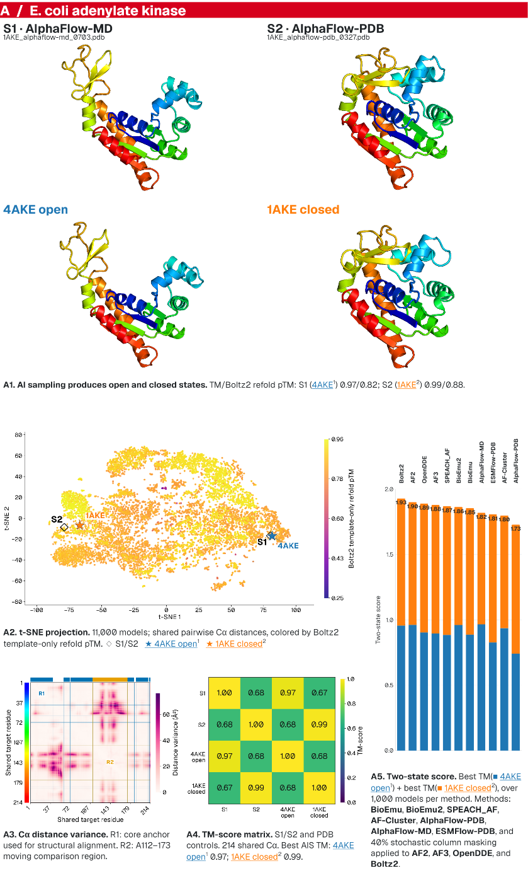
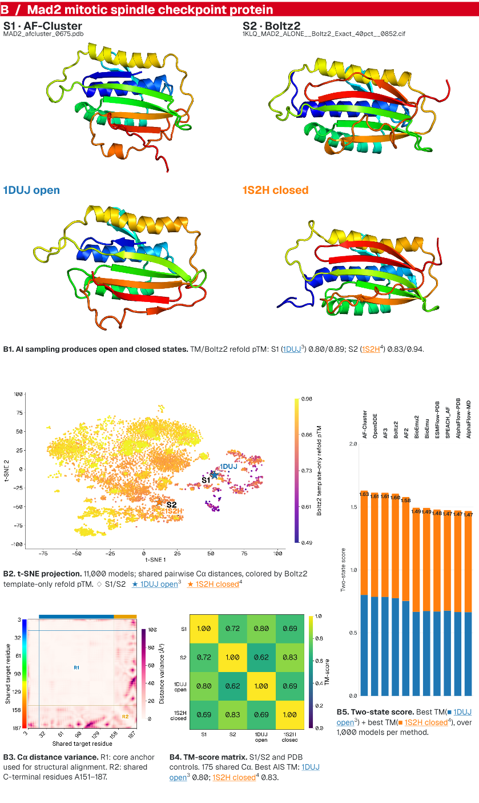

# AI sampling of protein conformational landscapes

Code and documentation for **Beyond a Single Structure: Exploring Multistate Protein Conformational Landscapes with AI Structure Prediction**, by T.L. Benavides and G.T. Montelione.

[Final poster PDF](poster/final/SCHERAGA_poster_36x48_both_11methods_print_v014.pdf) · [Study guide](docs/SCHERAGA-study.md) · [Adk dataset](https://doi.org/10.5281/zenodo.23601146) · [Mad2 dataset](https://doi.org/10.5281/zenodo.23601144) · [Source release](https://github.com/benavt/SCHERAGA_POSTER/releases/tag/scheraga-poster-v1.0.0)

The **final physical poster** is preserved in [`poster/final/`](poster/final/README.md): [full-resolution print PDF](poster/final/SCHERAGA_poster_36x48_both_11methods_print_v014.pdf?raw=true), [smaller phone PDF](poster/final/SCHERAGA_poster_36x48_both_11methods_phone_v014.pdf?raw=true), preview and abstract. The owner confirmed this v014 export as final; its bytes are unchanged.

For printers with upload or memory limits, use the [compact print PDF (2.1 MB)](poster/print-friendly/SCHERAGA_poster_36x48_print_compact_v014.pdf?raw=true). It preserves the 36 × 48 inch layout and links, with a 120-dpi compressed image; the print master remains available above.

**Data availability:** Mad2 v1 is complete. Adk v1 was published after an upload failure and contains 9 of 14 expected files; its model-output archive is absent. A corrected version is needed under the existing Adk concept DOI. See [distribution status](docs/distribution-status.md) before downloading or reusing the data.

We compare AI-sampled protein conformations with experimental open and closed references, then explore them through projections, structural comparisons and synchronized molecular views. This independent repository is a **snapshot**, not a fork of the private development history.

| Target | Current models | Experimental controls |
| --- | ---: | --- |
| E. coli adenylate kinase | 11,000 monomers | [4AKE open](https://www.rcsb.org/structure/4AKE), [1AKE closed](https://www.rcsb.org/structure/1AKE) |
| Mad2 mitotic spindle checkpoint protein | 11,000 monomers | [1DUJ open](https://www.rcsb.org/structure/1DUJ), [1S2H closed](https://www.rcsb.org/structure/1S2H) |

Each target has 1,000 predictions from AF2/AFSample2, AF3/AFSample3, OpenDDE, Boltz2, BioEmu, BioEmu2-preview, SPEACH_AF, AF-Cluster, AlphaFlow-PDB, AlphaFlow-MD and ESMFlow-PDB. The original four methods use stochastic 40% MSA column masking; additional methods retain their native protocols. Native physicality-filter failures remain in the analysis with flags.

## Explore

- [Study guide and selected states](docs/SCHERAGA-study.md)
- [Adk eleven-method analysis](docs/SCHERAGA-Adk-eleven-methods.md) and [Mad2 eleven-method analysis](docs/SCHERAGA-Mad2-eleven-methods.md)
- [Method papers, software and references](docs/SCHERAGA-references.md)
- [Measured original AIS versus matched refold TM similarity](docs/SCHERAGA-original-refold-TM.md)
- [Physical poster](poster/README.md), [interactive poster](site/README.md), [data availability](data/README.md) and [Zenodo handling](zenodo/README.md)
- [Distribution status and remaining release work](docs/distribution-status.md). The final physical poster is available in this repository; interactive poster v025 remains local. The [poster landing page](https://scheraga-poster.netlify.app) currently displays disabled “Coming soon” links.
- [Zenodo metadata rework plan](zenodo/metadata-rework-plan.md): resume later to revise titles, descriptions and field handling, then prepare Adk's corrected version.

<table><tr><th>A · E. coli adenylate kinase</th><th>B · Mad2</th></tr><tr><td width="50%"></td><td width="50%"></td></tr></table>

## Scope and provenance

[Source provenance](docs/source-provenance.md) pins the imported source snapshot. This companion contains a small set of scoring/display adapters and conventions, not the complete clustering application or its environments. Scripts require externally supplied reviewed run plans, source files and dependencies; cloning this repository does not trigger analysis, folding, uploads or publication. Experimental references are controls, not AIS predictions. Confidence is not relative state population, and movie ordering is a structural-display heuristic, not a claimed physical pathway.

## Reuse

Code is MIT licensed, with the original copyright notice preserved. Authored poster text, documentation and data use [CC BY 4.0](LICENSE-CONTENT.md), excluding third-party material and logos, which retain their own terms. See [CITATION.cff](CITATION.cff), method references and the applicable dataset-version citation. Preserve the separate AlphaFold 3 output notices supplied with the data.

## Contributor safeguards

Set `FLEET_ROOT` privately to the Fleet checkout, then run `python3 tools/check_privacy.py --tracked` before every push. The adapter runs Fleet's unchanged checker with this project's portable path allowlist, adds private-path/address checks, and permits only the explicit public GitHub owner URL. Install the hook with `git config core.hooksPath .githooks`. Private machine bindings and tokens belong outside tracked content.

Run offline safety checks with `python3 -m unittest discover -s tests`. The Sandbox wrapper rejects production, publication, abbreviated flags and unauthenticated remote draft writes before calling upstream. Its source-archive allowlist adds this companion's tools, manifests and content directories; ignored private state is never selected.
