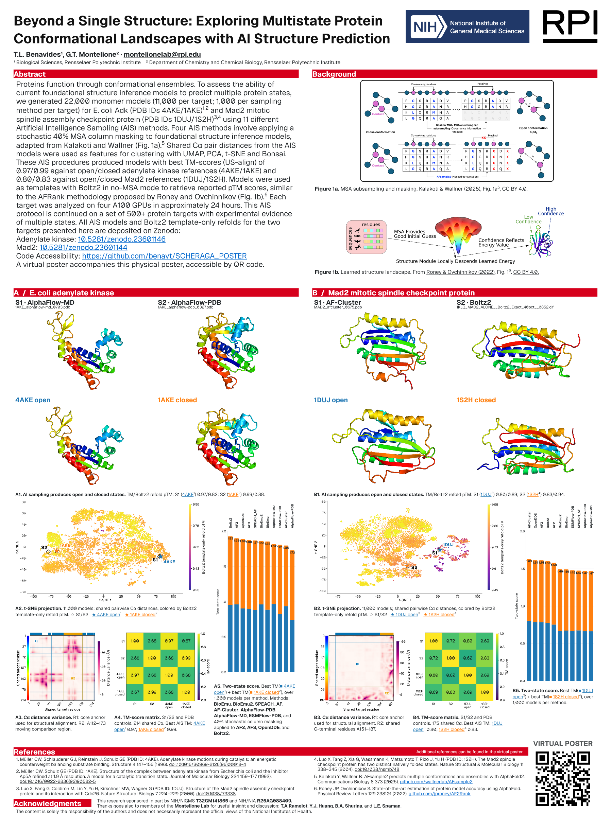

# Final physical poster

**Final version confirmed by the owner on 2026-10-23.** This is the approved v014 export, copied without editing, re-rendering or recompressing the files. Version numbers are retained for provenance.

| File | Purpose | Size |
| --- | --- | ---: |
| [Print PDF](SCHERAGA_poster_36x48_both_11methods_print_v014.pdf?raw=true) | Full-resolution 36 × 48 inch physical poster | 24.00 MB |
| [Phone PDF](SCHERAGA_poster_36x48_both_11methods_phone_v014.pdf?raw=true) | Smaller copy for screen reading | 11.16 MB |
| [Preview PNG](SCHERAGA_poster_36x48_both_11methods_v014_preview.png) | Quick visual preview | 1.92 MB |
| [Abstract text](abstract-verbatim-v014.txt) | Verbatim final abstract | 1.59 kB |

The [manifest](manifest.json) records exact byte counts and SHA-256 hashes. Verify downloaded files with `sha256sum -c SHA256SUMS` from this directory. The editable PPTX is retained locally.

The poster links the existing Adk and Mad2 concept DOIs. Adk's published v1 data upload is incomplete; see [distribution status](../../docs/distribution-status.md). That dataset correction does not change the owner's final-poster designation.

Authored poster content uses [CC BY 4.0](../../LICENSE-CONTENT.md); third-party material and logos retain their own terms.
